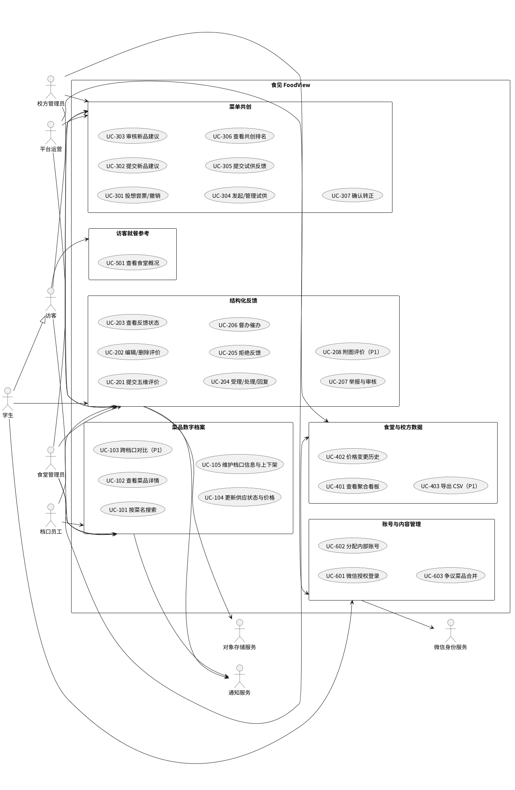
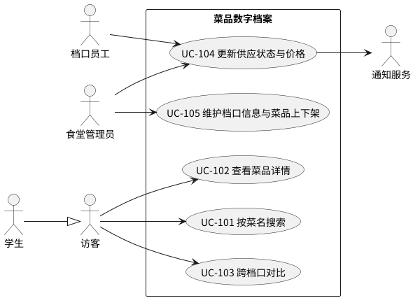
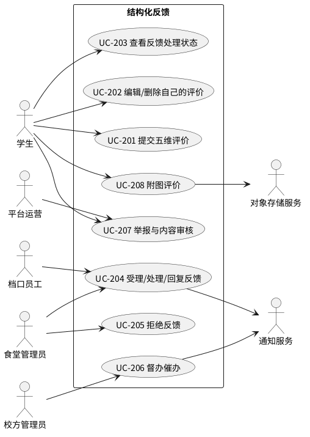
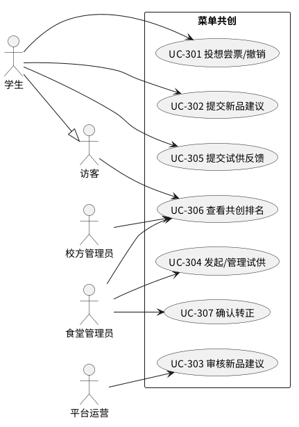
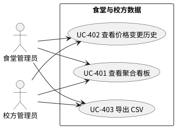
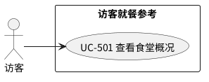
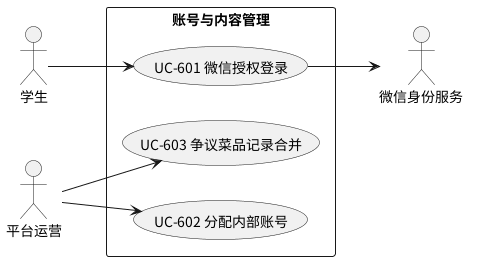
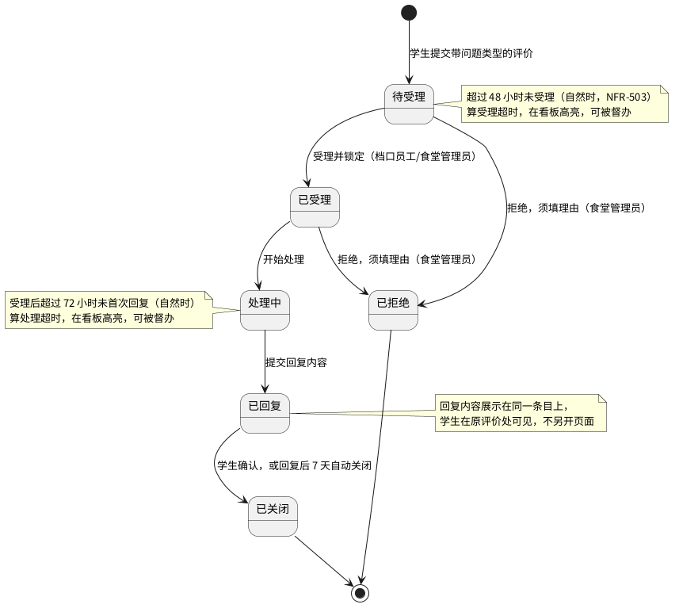

# 食见 FoodView 软件需求规格说明书（SRS）

| 项目 | 内容 |
| --- | --- |
| 文档编号 | FV-SRS-001 |
| 版本 | v0.1.1（草稿） |
| 日期 | 2026-11-27 |
| 依据标准 | IEEE Std 830-1998 |
| 状态 | 待评审 |

修订历史：

| 版本 | 日期 | 说明 |
| --- | --- | --- |
| v0.1 | 2026-11-26 | 初稿，覆盖全部功能模块与非功能需求 |
| v0.1.1 | 2026-11-27 | 修正链接大小写、编号笔误、文图一致性与 UC-202a/202b 优先级冲突，细化超时/编辑联动/并发锁定/共创排名与试供规则，补充非功能需求用例、v0.2 待补清单与附录 C 追踪表（对应 Issue #5） |

---

## 1 引言

### 1.1 编写目的

本文档定义"食见 FoodView"校园餐饮信息服务平台的完整软件需求，供开发、测试、课程评审与项目干系人作为后续设计、实现与验收的依据。预期读者：开发团队成员、测试人员、课程指导教师、食堂经营方与校方管理部门的代表。

### 1.2 产品范围

食见面向高校校园餐饮场景，以**单道菜品**为中心组织信息，把分散在各食堂公示栏与微信群的菜品、价格、供应状态与学生反馈集中到一个入口，并让每条反馈的处理状态可查、可追踪。

本期需求覆盖以下范围：

- 菜品数字档案：菜品跨食堂、跨档口的查询、对比与信息维护；
- 结构化反馈：五维评分、问题类型标注、反馈处理闭环；
- 菜单共创：菜品投票、新品建议、试供与排名；
- 食堂与校方数据：按食堂、档口、菜品、时间段的聚合看板；
- 访客就餐参考：免注册的食堂与菜品公开查询；
- 账号与内容管理：微信登录、内部账号分配、内容审核。

不在本期范围内：移动 App（原生）与其他小程序平台（支付宝等）、支付与订餐、外卖配送、多校区以外的组织架构管理。每个需求条目标注优先级：**P0** 为本期必须实现的核心需求，**P1** 为本期应实现但可在评审后调整或顺延的增强需求。

### 1.3 术语与缩略语

| 术语 | 定义 |
| --- | --- |
| 档口 | 食堂内一个独立经营单元，菜品的最小归属单位 |
| 菜品档案 | 一道菜的全校唯一记录，可被多个档口同时供应 |
| 五维评分 | 口味、价格、分量、供应、卫生五个维度各 1–5 星的评分体系 |
| 问题类型 | 评价上可多选的标注：异物、分量不足、价格异常、排队过长、卫生、其他 |
| 想尝票 | 学生对菜品投出的支持票，可撤销 |
| 试供 | 食堂对新菜开展的限时段供餐试验，期间定向收集反馈 |
| 转正 | 试供结束后菜品转为常规供应 |
| 反馈 | 学生提交的评价及其附带的问题条目的统称 |
| 督办 | 校方对超时未处理的反馈标记催办 |
| 内部账号 | 档口员工、食堂管理员、校方管理员、平台运营四类账号 |

### 1.4 参考文献

- IEEE Std 830-1998, *Recommended Practice for Software Requirements Specifications*
- 《食见 FoodView》README.md（产品背景与功能规划）
- CONVENTION.md / AGENTS.md（工程约定，含技术未决项清单）
- 微信开放平台小程序开发文档（登录、基础库兼容要求）

### 1.5 文档概述

第 2 章给出产品的总体描述：前景、功能总表、用户特征、约束与假设。第 3 章给出具体需求：3.1 功能需求按六个模块组织，每个模块包含需求条目、用例图与用例规约（P0 用例为完整规约表，P1 用例为简表）；3.2 非功能需求（含关键非功能需求用例）；3.3 外部接口需求。附录 A 给出反馈状态机，附录 B 给出评分与问题类型数据字典，附录 C 给出需求与用例追踪表。

图件约定：用例图与状态机图以 PNG 图片嵌入本文档；PlantUML 源文件位于 `docs/assets/srs/`，修改源文件后用 `plantuml -tpng` 重新渲染同名 PNG。

用例图约定：**主参与者**（发起用例的人或组织）画在用例左侧；**次参与者**（用例执行中被依赖的系统级服务）画在右侧。图中 `学生 --|> 访客` 表示学生是访客的特化：登录后的学生可执行访客的全部只读用例。

---

## 2 总体描述

### 2.1 产品前景

当前高校餐饮信息分散：菜品与价格贴在各食堂公示栏，供应变化发在若干微信群，学生反馈没有统一入口、提了没人跟。食见把这些收进一个平台，使学生"查一道菜"不需要先选食堂、再选楼层、最后找档口；使食堂看到哪些问题被反复提出；使校方拿到按食堂、档口、菜品、时间段聚合的数据；使校外访客进校之前就知道去哪个食堂、几点开门、大概花多少钱。

产品形态为 uni-app 双端发布：H5 网页 + 微信小程序。后端为单一 Spring Boot 服务。

### 2.2 产品功能总表

| 模块 | 功能 | 优先级 |
| --- | --- | --- |
| 菜品数字档案 | 按菜名搜索、查看菜品详情、跨档口对比、供应状态与价格维护 | P0；对比视图 P1 |
| 结构化反馈 | 五维评价、问题类型、处理状态闭环、督办、内容审核 | P0；附图评价 P1 |
| 菜单共创 | 想尝票、新品建议、试供管理、排名 | P0 |
| 食堂与校方数据 | 聚合看板、价格变更历史 | P0；CSV 导出 P1 |
| 访客就餐参考 | 免注册的食堂概况与菜品公开查询 | P0 |
| 账号与内容管理 | 微信登录、内部账号分配、内容审核与封禁 | P0 |

### 2.3 用户特征

| 用户角色 | 特征与权限概述 |
| --- | --- |
| 学生 | 在校学生，通过微信授权登录。可执行全部查询，并可评价、投票、提建议、看反馈状态。是平台最主要的用户。 |
| 访客 | 未登录用户，含校外访客与未登录学生。只读全部公开内容（菜品、价格、供应状态、评价摘要、排名、食堂概况），不能执行任何交互型用例。 |
| 档口员工 | 食堂档口的日常操作人员。仅能维护**本档口**的供应状态与价格，受理、处理分派到本档口的反馈。 |
| 食堂管理员 | 一个食堂的管理者。维护本食堂的档口信息（位置、开放时间）与菜品上架/下架，处理本食堂全部反馈，发起试供并决定转正。 |
| 校方管理员 | 校方管理部门人员。只读全量聚合数据，可对反馈督办催办，不直接修改处理结果。 |
| 平台运营 | 平台的系统管理员。分配内部账号、审核新品建议与评价内容、处理举报、合并争议菜品记录。 |

权限边界约束：档口员工与食堂管理员的数据权限以"本档口/本食堂"为边界；校方管理员无写入业务数据的权限；平台运营不参与日常业务处理。

### 2.4 约束

- C1 双端发布：同一 uni-app 代码库编译到 H5 与微信小程序；小程序主包不超过 2MB。
- C2 小程序真机访问要求 HTTPS 且域名已备案；开发期仅可在开发者工具中联调。
- C3 数据库结构变更只能通过 Flyway 迁移脚本完成，已提交的迁移不允许修改。
- C4 所有业务接口返回统一信封 `{code, message, data}`，HTTP 状态码保持其标准语义；分页列表统一采用 `{records, total, page, size}` 结构。
- C5 敏感凭据（数据库口令、密钥）不得进入代码仓库；本地开发口令除外。
- C6 时区统一为 Asia/Shanghai，展示格式 `yyyy-MM-dd HH:mm:ss`。

### 2.5 假设与依赖

- A1 假设学生群体主要为微信用户，微信授权登录可覆盖绝大多数学生；不提供手机号/邮箱注册通道。
- A2 假设食堂经营方愿意安排档口员工日常维护供应状态；价格由档口自定，平台不干预定价。
- A3 假设初始菜品档案由各食堂管理员在上线前批量录入（上架流程亦可用于录入）。
- A4 依赖微信开放平台提供授权登录与小程序运行环境。

### 2.6 技术未决项（不影响需求定义）

以下实现层决策延后到设计阶段，本文档只规定"做什么"，不规定"用什么做"（与 AGENTS.md 第 8 节一致）：

| 未决项 | 对需求的影响 |
| --- | --- |
| 鉴权框架选型（Sa-Token vs Spring Security + JWT） | 不影响 FR-611 的功能定义；影响内部实现 |
| 对象存储与图片上传方案 | FR-218（附图评价）为 P1，待存储方案确定后实施 |
| Redis 缓存 | 不影响需求；为满足 NFR-501 性能指标提供手段之一 |
| API 文档与前端类型生成 | 不影响需求；交付形态未定 |

以下细化需求经 Issue #5 评审确认纳入 **v0.2 待补清单**（本期不提前写死）：

- 内部账号登录与首次改密完整流程（待 2.6 鉴权选型定稿后补充，避免重复返工）；
- 问题条目已回复、已关闭、已拒绝状态是否允许重开；
- 评价删除或下架后关联处理记录与历史统计数据的保留细则；
- 用户昵称来源、账号停用细节、数据保存期限与用户注销后的处理；
- 投票防刷、重复评价进阶限制与审核申诉流程。

### 2.7 运行环境

- 服务端：Linux 服务器，JDK 25，Spring Boot，MySQL 8.4，服务端口 8080，接口前缀 `/api`。
- 客户端：现代浏览器（Chrome / Edge / Safari / Firefox 最近两年主要版本）访问 H5；微信小程序基础库兼容策略见 NFR-504。
- 开发环境：Docker Compose 承载 MySQL；应用进程不容器化。

---

## 3 具体需求

### 3.1 功能需求

需求条目编号规则：`FR-<模块号><序号>`，用例编号规则：`UC-<模块号><序号>`；需求与用例允许存在一对多或多对一关系，完整映射见附录 C 追踪表。

#### 3.1.0 用例总图

*用例总图（源文件：[`assets/srs/uc-000.puml`](assets/srs/uc-000.puml)）*

> 总图中的连线是**模块级**的：参与者到模块包的连线仅表示该参与者参与该模块内至少一个用例（如访客对菜单共创仅参与 UC-306 查看排名）。精确到每个用例的主/次参与者见各模块图。图中 `学生 --|> 访客` 表示学生是访客的特化；次参与者（微信身份服务、通知服务、对象存储服务）画在右侧，均为系统级依赖，不是人。

#### 3.1.1 菜品数字档案

*菜品数字档案用例图（源文件：[`assets/srs/uc-100.puml`](assets/srs/uc-100.puml)）*

**需求条目**

- FR-101（P0）按菜名搜索：输入菜名关键词，返回全校供应该菜的档口列表（已下架菜品不返回；当日售罄保留并标注"已售罄"，排在有货的后面），含食堂、位置、当前价格、供应状态与五维评分摘要。
- FR-102（P0）菜品详情：展示某档口某道菜的所属档口、当前价格、供应状态（在售/售罄/限时）、五维评分摘要、想尝票数、近期评价列表。
- FR-103（P1）跨档口对比：同一菜品在多个档口间的价格与评分并排对比视图。
- FR-104（P0）供应状态与价格维护：档口员工更新本档口菜品的供应状态与价格；"限时"必须填写起止时间，到期自动转售罄；每次价格变更写入价格历史。
- FR-105（P0）档口信息与菜品上下架：食堂管理员维护本食堂档口的位置、开放时间，执行菜品上架（创建或关联已有菜品档案）与下架。

**P0 用例规约**

UC-101 按菜名搜索

| 项目 | 内容 |
| --- | --- |
| 主参与者 | 访客（含学生） |
| 次参与者 | 无 |
| 前置条件 | 无（免登录） |
| 主成功场景 | 1. 用户在搜索框输入菜名关键词 2. 系统返回匹配的菜品档案列表 3. 用户选择一道菜，系统列出全校供应该菜的档口及价格、状态 4. 用户可进一步查看某档口详情（进入 UC-102） |
| 备选流 | 2a. 无匹配结果：系统提示"未找到"，并推荐相近菜名 2b. 关键词为空或超长：系统提示并拒绝提交 |
| 后置条件 | 无状态变更 |

UC-102 查看菜品详情

| 项目 | 内容 |
| --- | --- |
| 主参与者 | 访客（含学生） |
| 次参与者 | 无 |
| 前置条件 | 目标菜品在本档口处于上架状态 |
| 主成功场景 | 1. 用户从搜索结果或档口页进入菜品详情 2. 系统展示价格、供应状态、五维评分摘要、想尝票数 3. 系统展示近期评价列表（分页） |
| 备选流 | 2a. 无评价：显示"暂无评价"引导文案 |
| 后置条件 | 无状态变更 |

UC-104 更新供应状态与价格

| 项目 | 内容 |
| --- | --- |
| 主参与者 | 档口员工、食堂管理员 |
| 次参与者 | 通知服务（供应恢复时通知关注者，P1 预留） |
| 前置条件 | 已登录内部账号；目标菜品属于其权限范围内的档口 |
| 主成功场景 | 1. 员工选择本档口菜品，选择新供应状态（在售/售罄/限时） 2a. 若选择"限时"，系统要求填写起止时间，校验起 < 止 2b. 若修改价格，系统要求填写新价格，校验为正数且精度到分 3. 系统保存变更；价格变更同时写入价格历史（时间、原价、新价） 4. 系统向前台立即反映新状态 |
| 备选流 | 2a-1. 起止时间非法：系统提示并拒绝保存 2b-1. 价格非法：系统提示并拒绝保存 1a. 试图修改非本档口菜品：系统返回 403 |
| 后置条件 | 供应状态/价格已更新；限时到期由系统自动转售罄 |

UC-105 维护档口信息与菜品上下架

| 项目 | 内容 |
| --- | --- |
| 主参与者 | 食堂管理员 |
| 次参与者 | 无 |
| 前置条件 | 已登录食堂管理员账号 |
| 主成功场景 | 1. 管理员编辑本食堂某档口的位置、开放时间 2. 管理员为档口上架菜品：从已有菜品档案关联，或新建菜品档案 3. 管理员对档口菜品执行下架 |
| 备选流 | 2a. 新建档案与已有菜品疑似重复：系统提示相近档案，管理员可选择关联或确认新建（重复档案交由平台运营按 UC-603 合并） |
| 后置条件 | 档口信息或菜品上下架状态已生效；新建档案进入全局菜品库 |

**P1 简表**

| 用例 | 主参与者 | 主流程摘要 |
| --- | --- | --- |
| UC-103 跨档口对比 | 访客（含学生） | 在菜品详情选择"对比"，系统并排展示各档口价格与五维评分 |

#### 3.1.2 结构化反馈

*结构化反馈用例图（源文件：[`assets/srs/uc-200.puml`](assets/srs/uc-200.puml)）*

**需求条目**

- FR-211（P0）五维评价：学生对某档口某菜提交评价，口味、价格、分量、供应、卫生各 1–5 星，全部必填；可附文字。
- FR-212（P0）问题类型：评价时可多选问题类型（异物、分量不足、价格异常、排队过长、卫生、其他）；带问题类型的评价自动生成一条问题条目，进入处理流程。
- FR-213（P0）评价唯一性与可变性：同一学生对同一档口同一菜品同一天仅一条评价；作者可编辑（编辑后标"已修改"）或删除自己的评价。编辑时原无问题条目而新增问题类型的，补建一条"待受理"条目；已生成的问题条目不允许通过编辑撤销，仅允许补充说明。
- FR-214（P0）处理闭环：问题条目状态为 待受理→已受理→处理中→已回复→已关闭，另有已拒绝（见附录 A）；先受理者锁定条目，另一人仅可查看，锁定在状态流转时校验；回复后经学生确认或满 7 天自动关闭；学生可随时在原评价处查看状态变化，处理结果回复在同一条目上。
- FR-215（P0）拒绝：食堂管理员可拒绝问题条目，必须填写理由，学生可见理由。
- FR-216（P0）督办：校方管理员可对受理超时（48 小时未受理）或处理超时（受理后 72 小时未首次回复）的问题条目标记督办，系统通过站内消息通知对应食堂管理员；校方不能修改处理结果。
- FR-217（P0）内容安全：评价文字先发后审；任何登录学生可举报评价；平台运营审核举报并可下架违规评价（下架对作者提示"内容被移除"）。昵称展示，不显示真实姓名。
- FR-218（P1）附图评价：评价可附图片，依赖对象存储能力（见 2.6 与 3.3）。

**P0 用例规约**

UC-201 提交五维评价

| 项目 | 内容 |
| --- | --- |
| 主参与者 | 学生 |
| 次参与者 | 无 |
| 前置条件 | 学生已微信授权登录；目标菜品在售或当日有售 |
| 主成功场景 | 1. 学生在菜品详情选择"写评价" 2. 学生为五维各打 1–5 星（全部必填），填写文字，可多选问题类型 3. 系统校验五维均已完成、文字长度在限内 4. 系统保存评价并刷新评分摘要 5. 若含问题类型，系统创建问题条目，状态置"待受理" |
| 备选流 | 3a. 某维度未评分：系统提示"请完成全部五个维度" 4a. 该学生当日对该菜已有评价：系统提示跳转编辑（UC-202a）而非新建 1a. 未登录：系统引导至 UC-601 |
| 后置条件 | 评价可见；问题条目（若有）进入处理流程 |

UC-202a 编辑评价

| 项目 | 内容 |
| --- | --- |
| 主参与者 | 学生 |
| 次参与者 | 无 |
| 前置条件 | 学生已登录；目标评价为本人发布且未被下架 |
| 主成功场景 | 1. 学生在自己的评价处选择"编辑" 2. 学生修改五维评分、文字内容或问题类型 3. 系统校验五维评分完整、文字长度在限内 4. 系统保存更新并标记"已修改"，刷新菜品评分摘要 5. 若原无问题条目且本次新增了问题类型，系统补建一条"待受理"问题条目 |
| 备选流 | 1a. 试图编辑他人评价：系统返回 403 2a. 试图取消已生成问题条目的问题类型勾选：系统保留既有问题条目不允许撤销，仅允许补充说明 3a. 校验失败：提示并拒绝保存 |
| 后置条件 | 评价已更新并标"已修改"；问题条目按 FR-213 规则保持一致 |

UC-202b 删除评价

| 项目 | 内容 |
| --- | --- |
| 主参与者 | 学生 |
| 次参与者 | 无 |
| 前置条件 | 学生已登录；目标评价为本人发布 |
| 主成功场景 | 1. 学生在自己的评价处选择"删除"并二次确认 2. 系统删除该评价并刷新菜品评分摘要 3. 若存在关联问题条目：未进入处理流程的条目同步清理；处理中或已回复的条目解除评价关联但保留处理轨迹 |
| 备选流 | 1a. 试图删除他人评价：系统返回 403 1b. 学生取消二次确认：不执行删除 |
| 后置条件 | 评价不再公开展示；已进入处理流程的问题轨迹不丢失 |

UC-203 查看反馈处理状态

| 项目 | 内容 |
| --- | --- |
| 主参与者 | 学生 |
| 次参与者 | 无 |
| 前置条件 | 学生已登录 |
| 主成功场景 | 1. 学生打开"我的反馈"列表 2. 系统列出其全部问题条目及当前状态、最近处理动作 3. 学生可查看某条目的完整处理过程（受理时间、回复内容） |
| 备选流 | 2a. 无任何条目：显示引导文案 |
| 后置条件 | 无状态变更 |

UC-204 受理/处理/回复反馈

| 项目 | 内容 |
| --- | --- |
| 主参与者 | 档口员工、食堂管理员 |
| 次参与者 | 通知服务（P0 采用站内消息，微信推送后置） |
| 前置条件 | 已登录内部账号；条目属于其权限范围 |
| 主成功场景 | 1. 处理人在待受理列表选择条目，执行"受理"（状态→已受理），系统锁定该条目归属当前受理人，另一角色仅可查看 2. 受理人执行"开始处理"（状态→处理中），可补充内部备注 3. 受理人填写回复内容并提交（状态→已回复） 4. 系统发送站内通知提醒学生在原条目处查看回复 |
| 备选流 | 1a. 试图操作非本权限条目：系统返回 403 1b. 条目已被他人受理锁定：系统校验锁定归属并拒绝重复受理或推进状态，仅允许查看 3a. 回复为空：系统提示并拒绝提交 |
| 后置条件 | 状态推进；锁定归属与流转轨迹留存；回复内容对学生可见 |

UC-205 拒绝反馈

| 项目 | 内容 |
| --- | --- |
| 主参与者 | 食堂管理员 |
| 次参与者 | 无 |
| 前置条件 | 已登录食堂管理员账号；条目处于待受理或已受理状态 |
| 主成功场景 | 1. 管理员选择条目执行"拒绝" 2. 系统要求填写拒绝理由（必填） 3. 系统保存，状态置"已拒绝"，学生可见理由 |
| 备选流 | 2a. 理由为空：系统提示并拒绝提交 |
| 后置条件 | 条目终止于"已拒绝"，学生收到状态变更 |

UC-206 督办催办

| 项目 | 内容 |
| --- | --- |
| 主参与者 | 校方管理员 |
| 次参与者 | 通知服务（P0 采用站内消息，微信推送后置） |
| 前置条件 | 已登录校方管理员账号；条目已超时（超过 NFR-503 受理时限 48 小时未受理，或受理后超过 72 小时未首次回复，均按自然时计） |
| 主成功场景 | 1. 校方在聚合看板或条目列表发现超时条目 2. 校方执行"督办"，可选填督办说明 3. 系统记录督办标记并通过站内消息通知对应食堂管理员 |
| 备选流 | 2a. 条目未超时：系统提示"该条目尚未超时"并允许附言 |
| 后置条件 | 条目带督办标记；食堂管理员收到通知；校方不能改处理结果 |

UC-207 举报与内容审核

| 项目 | 内容 |
| --- | --- |
| 主参与者 | 学生（举报）、平台运营（审核） |
| 次参与者 | 无 |
| 前置条件 | 举报人已登录；审核人已登录运营账号 |
| 主成功场景 | 1. 学生对某条评价选择"举报"，选择举报类型（可附说明） 2. 系统记录举报并进入运营审核队列 3. 运营查看被举报评价，执行"下架"（填写原因）或"驳回举报" 4a. 下架后评价对所有人不可见，作者看到"内容被移除"提示 |
| 备选流 | 3a. 同一评价被多人重复举报：合并为一条审核任务 |
| 后置条件 | 违规内容被移除或举报被驳回；处置记录留存 |

**P1 简表**

| 用例 | 主参与者 | 主流程摘要 |
| --- | --- | --- |
| UC-208 附图评价 | 学生 | 提交评价时上传图片（≤3 张），经对象存储服务保存并展示 |

#### 3.1.3 菜单共创

*菜单共创用例图（源文件：[`assets/srs/uc-300.puml`](assets/srs/uc-300.puml)）*

**需求条目**

- FR-321（P0）想尝票：学生对任意在档菜品投"想尝"票；每人每菜一票，可撤销；不设反对票；与新品建议票分开统计，在档菜品的想尝票单列展示，不混入试供排名。
- FR-322（P0）新品建议：学生提交新品建议（菜名、描述、可选期望档口）；先经平台运营审核，通过后公开展示并接受投票（与在档菜品想尝票分开统计）。
- FR-323（P0）试供：食堂管理员为某档口发起试供，必须设定起止时间（1–14 天）；试供期内该菜以"限时"状态供应；试供期定向收集"五维评分 + 是否希望转正"。
- FR-324（P0）排名：试供结束后系统仅对试供菜品生成排名，常规想尝票数优先，同票按试供期综合评分（五维均分）排序；在档菜品的想尝票单列一栏展示，不混入试供排名；作为排菜与调整供应的参考。
- FR-325（P0）转正：试供结束后菜品自动转下架，除非食堂管理员在试供记录中确认转正（转为常规供应）。

**P0 用例规约**

UC-301 投想尝票/撤销

| 项目 | 内容 |
| --- | --- |
| 主参与者 | 学生 |
| 次参与者 | 无 |
| 前置条件 | 学生已登录 |
| 主成功场景 | 1. 学生在菜品详情选择"想尝" 2. 系统记录一票并刷新票数 3. 学生再次选择可撤销该票，票数减少 |
| 备选流 | 1a. 未登录：引导至 UC-601 2a. 已投过：按钮呈已投状态，重复点击进入撤销路径而非重复计票 |
| 后置条件 | 票数正确增减；每人每菜至多一票 |

UC-302 提交新品建议

| 项目 | 内容 |
| --- | --- |
| 主参与者 | 学生 |
| 次参与者 | 无 |
| 前置条件 | 学生已登录 |
| 主成功场景 | 1. 学生填写菜名、描述，可选期望档口 2. 系统校验必填与长度限制 3. 系统保存为"待审核"状态，不公开展示 |
| 备选流 | 2a. 菜名与已有菜品高度相似：系统提示已存在档案，建议改为投想尝票 2b. 校验失败：提示并拒绝提交 |
| 后置条件 | 建议进入运营审核队列 |

UC-303 审核新品建议

| 项目 | 内容 |
| --- | --- |
| 主参与者 | 平台运营 |
| 次参与者 | 无 |
| 前置条件 | 已登录运营账号；存在待审核建议 |
| 主成功场景 | 1. 运营查看建议详情 2. 运营执行"通过"（建议公开展示并接受投票）或"驳回"（填写理由，学生可见） |
| 备选流 | 2a. 建议内容违规：驳回并可同时限制提交者短期提建议权限 |
| 后置条件 | 建议状态为已通过（公开）或已驳回（含理由） |

UC-304 发起/管理试供

| 项目 | 内容 |
| --- | --- |
| 主参与者 | 食堂管理员 |
| 次参与者 | 无 |
| 前置条件 | 已登录食堂管理员账号；目标档口与菜品档案已存在 |
| 主成功场景 | 1. 管理员选择档口与菜品，填写试供起止时间与说明 2. 系统校验起 < 止，且时长在 1–14 天内（超出直接拒绝） 3. 系统创建试供活动，菜品在试供期以"限时"状态供应，面向学生展示"试供中"标识 4. 到期后系统结束试供，菜品转下架，生成排名结果 |
| 备选流 | 2a. 时间非法或档口冲突：提示并拒绝 4a. 管理员在到期前手动结束：按同样规则生成排名 |
| 后置条件 | 试供活动及其定向反馈数据留存 |

UC-305 提交试供反馈

| 项目 | 内容 |
| --- | --- |
| 主参与者 | 学生 |
| 次参与者 | 无 |
| 前置条件 | 学生已登录；存在进行中的试供活动 |
| 主成功场景 | 1. 学生在试供菜品详情选择"提交试供反馈" 2. 学生完成五维评分并选择"是否希望转正"（是/否） 3. 系统保存定向反馈，计入该菜试供统计 |
| 备选流 | 2a. 五维未完成：提示并拒绝 2b. 活动已结束：入口关闭并提示 |
| 后置条件 | 试供统计更新 |

UC-306 查看共创排名

| 项目 | 内容 |
| --- | --- |
| 主参与者 | 访客（含学生）、食堂管理员、校方管理员 |
| 次参与者 | 无 |
| 前置条件 | 存在已结束的试供或公开投票数据 |
| 主成功场景 | 1. 用户打开排名页 2. 系统按 FR-324 规则展示试供菜品排名（想尝票数、试供综合评分、试供期"希望转正"比例），并单列展示在档菜品想尝票栏 |
| 备选流 | 2a. 无数据：显示引导文案 |
| 后置条件 | 无状态变更 |

UC-307 确认转正

| 项目 | 内容 |
| --- | --- |
| 主参与者 | 食堂管理员 |
| 次参与者 | 无 |
| 前置条件 | 试供已结束且菜品当前为下架状态 |
| 主成功场景 | 1. 管理员在试供记录中查看排名与定向反馈 2. 管理员执行"转正"，菜品恢复常规供应（在售/售罄由档口日常维护） |
| 备选流 | 2a. 管理员选择"不转正"或超时不处理：菜品保持下架，试供数据留存 |
| 后置条件 | 菜品供应状态由管理员决定并生效 |

#### 3.1.4 食堂与校方数据

*食堂与校方数据用例图（源文件：[`assets/srs/uc-400.puml`](assets/srs/uc-400.puml)）*

**需求条目**

- FR-431（P0）聚合看板：按食堂、档口、菜品、时间段（日/周/月）聚合反馈量、五维均值、问题类型分布、想尝票与排名变化。食堂管理员仅见本食堂；校方见全校。
- FR-432（P0）价格变更历史：任一菜品的价格变更记录（时间、原价、新价、操作档口），供判断"价格异常"问题。
- FR-433（P1）CSV 导出：看板当前筛选结果导出为 CSV 文件。

**P0 用例规约**

UC-401 查看聚合看板

| 项目 | 内容 |
| --- | --- |
| 主参与者 | 食堂管理员（本食堂范围）、校方管理员（全校范围） |
| 次参与者 | 无 |
| 前置条件 | 已登录相应内部账号 |
| 主成功场景 | 1. 用户选择聚合维度：食堂/档口/菜品/时间段，时间粒度日/周/月 2. 系统展示反馈量、五维均值、问题类型分布、想尝票数与排名变化 3. 用户下钻到某档口/某菜品的明细 |
| 备选流 | 1a. 选择的组合无数据：展示空态 2a. 食堂管理员试图查看非本食堂：系统返回 403 |
| 后置条件 | 无状态变更 |

UC-402 查看价格变更历史

| 项目 | 内容 |
| --- | --- |
| 主参与者 | 食堂管理员、校方管理员 |
| 次参与者 | 无 |
| 前置条件 | 已登录相应内部账号 |
| 主成功场景 | 1. 用户选择菜品与时间范围 2. 系统按时间倒序展示价格变更记录（时间、原价、新价、操作档口） |
| 备选流 | 2a. 无记录：显示"价格未变过" |
| 后置条件 | 无状态变更 |

**P1 简表**

| 用例 | 主参与者 | 主流程摘要 |
| --- | --- | --- |
| UC-403 导出 CSV | 食堂管理员、校方管理员 | 在看板当前筛选条件下执行"导出"，系统生成 CSV 文件供下载 |

#### 3.1.5 访客就餐参考

*访客就餐参考用例图（源文件：[`assets/srs/uc-500.puml`](assets/srs/uc-500.puml)）*

**需求条目**

- FR-511（P0）食堂概况：面向所有人的食堂列表与详情：位置、开放时间、价格区间、菜品分布（各价格带/各品类数量）。免注册、免登录。
- FR-512（P0）公开只读：访客可读全部公开内容（含评价摘要、排名、反馈统计），交互型用例（评价、投票、提建议、试供反馈）才要求登录（访客与学生共享只读查询用例）。

**P0 用例规约**

UC-501 查看食堂概况

| 项目 | 内容 |
| --- | --- |
| 主参与者 | 访客（含校外访客与未登录学生） |
| 次参与者 | 无 |
| 前置条件 | 无 |
| 主成功场景 | 1. 访客打开食堂列表，系统展示各食堂位置、开放时间、价格区间 2. 访客进入某食堂，系统展示档口分布与菜品分布（价格带/品类） 3. 访客可继续按菜名搜索（进入 UC-101） |
| 备选流 | 2a. 某食堂信息未维护完整：显示已维护部分，缺失字段标注"暂无" |
| 后置条件 | 无状态变更 |

#### 3.1.6 账号与内容管理

*账号与内容管理用例图（源文件：[`assets/srs/uc-600.puml`](assets/srs/uc-600.puml)）*

**需求条目**

- FR-611（P0）微信授权登录：学生通过微信授权建立会话；查询类用例对未登录用户开放。技术选型未定（见 2.6）。
- FR-612（P0）内部账号：档口员工、食堂管理员、校方管理员、平台运营账号由平台运营创建与分配，不开放自注册；运营账号由初始部署引导创建。
- FR-613（P0）权限边界：档口员工仅可操作本档口数据；食堂管理员仅可操作本食堂数据；校方管理员全校只读 + 督办；越权访问返回 403。
- FR-614（P0）争议菜品合并：多个食堂管理员为同一道菜创建了重复档案时，平台运营执行合并，评价、票数归并到保留档案。

**P0 用例规约**

UC-601 微信授权登录

| 项目 | 内容 |
| --- | --- |
| 主参与者 | 学生 |
| 次参与者 | 微信身份服务 |
| 前置条件 | 用户在小程序内，或 H5 内可完成微信授权 |
| 主成功场景 | 1. 用户触发登录 2. 系统向微信身份服务请求授权并取得用户标识 3. 系统建立会话，用户获得交互型用例权限 |
| 备选流 | 2a. 用户拒绝授权：系统保持访客身份，仅开放只读功能 2b. 微信服务异常：提示"登录暂不可用"，保持访客身份 2c. 开发/演示期 H5 无微信网页授权环境：允许提供测试登录入口，但必须在构建期剔除，不得留作运行时配置开关，生产包严禁包含该入口 |
| 后置条件 | 会话建立；昵称在后续展示中使用 |

UC-602 分配内部账号

| 项目 | 内容 |
| --- | --- |
| 主参与者 | 平台运营 |
| 次参与者 | 无 |
| 前置条件 | 运营账号已存在 |
| 主成功场景 | 1. 运营创建账号，选择角色与数据范围（档口/食堂/学校） 2. 系统生成初始凭据并要求首次登录修改 3. 运营可停用账号 |
| 备选流 | 1a. 数据范围与角色不匹配（如档口员工未绑定档口）：系统提示并拒绝 |
| 后置条件 | 新账号可按 FR-613 边限使用 |

UC-603 争议菜品记录合并

| 项目 | 内容 |
| --- | --- |
| 主参与者 | 平台运营 |
| 次参与者 | 无 |
| 前置条件 | 存在疑似重复的菜品档案 |
| 主成功场景 | 1. 运营查看重复档案候选及其关联数据 2. 运营选择保留档案，其余合并入内 3. 系统归并评价、票数、价格历史到保留档案，被合并档案下线 |
| 备选流 | 2a. 判断并非重复：标记"非重复"，不再提示 |
| 后置条件 | 菜品档案唯一；历史数据不丢失 |

### 3.2 非功能需求

| 编号 | 类别 | 需求 |
| --- | --- | --- |
| NFR-501 | 性能 | 页面首屏可交互时间 ≤ 2s（常规网络）；查询类接口 P95 ≤ 500ms（待验证，待压测环境与测量周期确定后回填） |
| NFR-502 | 容量 | 支持 1 万注册学生、日均 5 万请求、峰值 100 QPS 量级，无需水平拆分（待验证，待压测环境就绪后回填） |
| NFR-503 | 时效性 | 受理时限 48 小时，受理后首次回复时限 72 小时，均按自然时计时（节假日本期不设例外）；两段超时条目均在看板高亮并可供校方督办（UC-206 前置） |
| NFR-504 | 兼容性 | H5：Chrome / Edge / Safari / Firefox 最近两年主要版本；小程序：微信基础库近两年主流版本；宽屏用媒体查询适配 PC 浏览 |
| NFR-505 | 安全性 | 全链路 HTTPS（生产）；接口按 FR-613 边界鉴权，越权返回 403；用户输入经服务端校验与转义，防注入与 XSS；凭据不入库（C5） |
| NFR-506 | 隐私 | 评价与反馈仅展示昵称；学生身份标识不对其他学生与档口可见；校方看到的统计为聚合数据 |
| NFR-507 | 可用性 | 布局使用 rpx 适配小屏；交互失败均有明确提示文案；空态有引导 |
| NFR-508 | 可维护性 | 遵循仓库 CI 与工程约定：提交须通过后端编译与验证（`./mvnw -B verify`）、前端 `type-check`、`build:h5` 与 `build:mp-weixin`；数据库结构变更仅经 Flyway 迁移 |
| NFR-509 | 可靠性 | 服务单实例部署下年度可用性目标 ≥ 99%（不含计划内维护，待验证，待部署监控与测量周期确定后回填）；数据变更操作幂等或失败可重试，不产生脏数据 |

**非功能需求用例**

UC-NFR-01 高峰期核心查询性能验证（对应 NFR-501、NFR-502）

| 项目 | 内容 |
| --- | --- |
| 触发场景 | 午晚餐高峰期并发访问按菜名搜索（UC-101）、菜品详情（UC-102）与聚合看板（UC-401） |
| 约束目标 | 模拟 100 QPS 持续请求下，核心查询接口 P95 响应时间 ≤ 500ms，错误率 = 0；常规网络下页面首屏可交互时间 ≤ 2s（以上指标当前标"待验证"，待压测环境与测量周期确定后回填实测基线） |
| 验证方式 | 使用压测工具（如 k6 / JMeter）对目标查询接口施加 100 QPS 负载并采集 P95 延迟；使用浏览器 Lighthouse / DevTools 测量 H5 首屏可交互时间 |

UC-NFR-02 多角色权限隔离与隐私脱敏验证（对应 NFR-505、NFR-506、FR-613）

| 项目 | 内容 |
| --- | --- |
| 触发场景 | 未登录访客尝试调用交互接口；档口员工越权修改其他档口菜品/反馈；食堂管理员越权查询其他食堂看板；校方管理员尝试修改反馈处理结果 |
| 约束目标 | 未登录调用受保护接口返回 HTTP 401；越权操作一律拦截并返回 HTTP 403 且不产生数据变更；公开评价与统计接口响应中仅含昵称或聚合数据，不泄露学生真实身份标识 |
| 验证方式 | 编写后端集成测试覆盖上述 6 类角色边界与未登录场景，校验 HTTP 状态码、统一响应信封与响应体脱敏字段 |

### 3.3 外部接口需求

| 接口 | 需求 |
| --- | --- |
| 微信授权登录 API | 依赖微信开放平台提供用户授权与身份标识；接口异常时降级为访客只读（见 UC-601 备选流） |
| 通知服务 | P0 阶段采用站内消息实现（UC-204、UC-206）；微信订阅消息推送后置 |
| 对象存储服务（P1） | 附图评价（FR-218）所需；选型未决，本节仅规定能力要求：支持图片直传或经后端中转、返回可公开访问的 URL、容量按 1 万学生规模估算 |
| HTTPS 备案域名 | 小程序真机访问要求 HTTPS 且域名已在微信平台备案登记；生产部署前必须完成 |

---

## 附录 A 反馈状态机

*反馈状态机图（源文件：[`assets/srs/feedback-state.puml`](assets/srs/feedback-state.puml)）*

约束：状态只能沿图示方向流转，不允许回退；每次流转记录操作人、时间与说明，形成对校方与管理员可见的处理轨迹。

## 附录 B 评分与问题类型数据字典

五维评分（均为 1–5 星整数，必填）：

| 维度 | 含义 |
| --- | --- |
| 口味 | 菜品味道本身 |
| 价格 | 性价比感知 |
| 分量 | 份量是否足够 |
| 供应 | 是否买得到、排队与供应稳定性 |
| 卫生 | 就餐环境与餐品卫生观感 |

问题类型（可多选，选中即生成问题条目）：

| 类型 | 说明 |
| --- | --- |
| 异物 | 餐品中出现异物 |
| 分量不足 | 实际分量明显少于标称 |
| 价格异常 | 与公示价不符或当日异常变动 |
| 排队过长 | 排队时长显著超出正常水平 |
| 卫生 | 卫生条件问题（非异物） |
| 其他 | 以上未覆盖的问题，须在文字中说明 |

优先级汇总：P0 共 24 条功能需求条目（FR-101/102/104/105、211–217、321–325、431/432、511/512、611–614）；P1 共 3 条（FR-103、218、433），可在评审后顺延至下一迭代。

## 附录 C 需求与用例追踪表

| 模块 | 需求条目 | 优先级 | 对应用例 |
| --- | --- | --- | --- |
| 菜品数字档案 | FR-101 按菜名搜索 | P0 | UC-101 |
| 菜品数字档案 | FR-102 菜品详情 | P0 | UC-102 |
| 菜品数字档案 | FR-103 跨档口对比 | P1 | UC-103 |
| 菜品数字档案 | FR-104 供应状态与价格维护 | P0 | UC-104 |
| 菜品数字档案 | FR-105 档口信息与菜品上下架 | P0 | UC-105 |
| 结构化反馈 | FR-211 五维评价 | P0 | UC-201 |
| 结构化反馈 | FR-212 问题类型 | P0 | UC-201 |
| 结构化反馈 | FR-213 评价唯一性与可变性 | P0 | UC-201、UC-202a、UC-202b |
| 结构化反馈 | FR-214 处理闭环 | P0 | UC-203、UC-204 |
| 结构化反馈 | FR-215 拒绝 | P0 | UC-205 |
| 结构化反馈 | FR-216 督办 | P0 | UC-206 |
| 结构化反馈 | FR-217 内容安全 | P0 | UC-207 |
| 结构化反馈 | FR-218 附图评价 | P1 | UC-208 |
| 菜单共创 | FR-321 想尝票 | P0 | UC-301 |
| 菜单共创 | FR-322 新品建议 | P0 | UC-302、UC-303 |
| 菜单共创 | FR-323 试供 | P0 | UC-304、UC-305 |
| 菜单共创 | FR-324 排名 | P0 | UC-306 |
| 菜单共创 | FR-325 转正 | P0 | UC-307 |
| 食堂与校方数据 | FR-431 聚合看板 | P0 | UC-401 |
| 食堂与校方数据 | FR-432 价格变更历史 | P0 | UC-402 |
| 食堂与校方数据 | FR-433 CSV 导出 | P1 | UC-403 |
| 访客就餐参考 | FR-511 食堂概况 | P0 | UC-501 |
| 访客就餐参考 | FR-512 公开只读 | P0 | UC-501、UC-101、UC-102、UC-103、UC-306 |
| 账号与内容管理 | FR-611 微信授权登录 | P0 | UC-601 |
| 账号与内容管理 | FR-612 内部账号 | P0 | UC-602 |
| 账号与内容管理 | FR-613 权限边界 | P0 | UC-104、UC-105、UC-204~206、UC-401、UC-602、UC-NFR-02 |
| 账号与内容管理 | FR-614 争议菜品合并 | P0 | UC-603 |
| 非功能需求 | NFR-501、NFR-502 性能与容量 | P0 | UC-NFR-01 |
| 非功能需求 | NFR-505、NFR-506 安全与隐私 | P0 | UC-NFR-02 |
